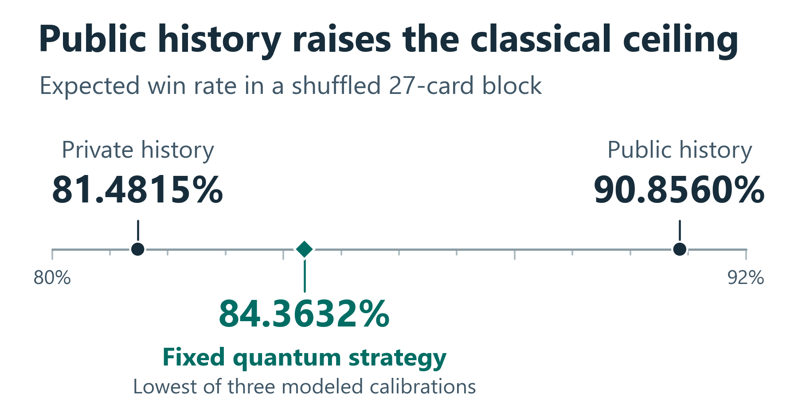

# Bell Game Audit

In a 27-round Bell game, the best classical team can win **22 of 27 rounds in expectation (81.48%)** when each player sees only their own questions. Announce the pair of questions after every round and the classical ceiling rises to **90.86%**. The deck, its shuffle, and the scoring rule stay fixed. The difference is what the players can learn about the remaining cards.

A fixed quantum strategy scores **84.36%** in the weakest of three modeled device configurations. It clears the private-history ceiling by **2.88 percentage points** and falls below the public-history ceiling by **6.49 points**. These are expected values from a model with specified detector losses and measurement angles. [Exact audit](quota_result.json) · [Device model](bell_game_audit/data/model.json)

[Read the research presentation (PDF)](presentation/bell-game-audit.pdf) · [Read the mathematical proof](PRIVATE_VALUE.md)



## A four-card example

Alice and Bob each receive one bit, privately, and answer with one bit. They win when their answers match, except when both questions are 1, in which case the answers must differ. This is the CHSH game. Any fixed pair of classical answer tables must fail on at least one of the four question pairs.

Put each pair on a card and shuffle the four cards. At every position, each pair still has probability ¼. The referee can reveal past question pairs immediately, after a delay, or after the block. Players may agree on a strategy in advance and keep their own histories. They receive no intermediate scores.

| Question pairs revealed before the next round | Round 1 | Round 2 | Round 3 | Round 4 | Mean win rate |
|---|---:|---:|---:|---:|---:|
| All completed pairs | ¾ | 1 | 1 | 1 | **15/16** |
| All except the most recent pair | ¾ | ¾ | 1 | 1 | **7/8** |
| All except the two most recent pairs | ¾ | ¾ | ¾ | 1 | **13/16** |
| Each player sees only their own inputs | ¾ | ¾ | ¾ | ¾ | **3/4** |

Once a past pair becomes public, both players can use an answer table whose only losing pair is that discarded card. They win every remaining round. The private-history result takes more work because the players hold different parts of the transcript. [Exact history enumeration](bell_game_audit/audit/private_history.py) · [Connection to card guessing](PRIOR_ART.md)

## What the certificates establish

Across **111,104 labelled games**, the optimal classical expected score with private input histories equals the score under independent draws from the same one-round distribution. Each game has three questions per player, a 27-card deck, and its own winning rule. There are 217 positive integer quota tables with cell counts from 1 to 5 and row and column sums of nine, and 512 binary target tables. The classical value varies from game to game. The same equality holds when all quotas of a certified game are multiplied by a positive integer. [Proof and scope](PRIVATE_VALUE.md) · [Full survey result](private_survey.json)

For the featured game, the certificate splits the deck into one nine-card rectangle and three six-card cycles. Even with private memory, the rectangle costs at least two expected losses and each cycle costs at least one. The players can attain exactly five losses by always answering zero. That proves the **22/27** ceiling. The independent verifier checks each component's local relabelings, coverage of all 27 cards, and its classical score. For the full grid, the survey checks 3,472 certificates and evaluates all 64 deterministic answer pairs against every original target. [Featured certificate](private_certificate.json) · [Independent verifier](bell_game_audit/certificates/verify.py)

With immediate public feedback, the best answer table can change as cards leave the deck. Averaging the optimal table over the possible remaining decks gives the featured game's exact classical ceiling of **492544354319/542115674100**. The fixed quantum strategy retains the same expected score because its response depends only on the current questions. The audit computes expected win rates. The distribution of a single block's score and the optimal adaptive quantum strategy remain open questions. [Round-by-round audit](quota_result.json)

## Reproduce the results

Run these commands from the repository directory with **Python 3.10 or later**. The small example and both independent verifiers use the standard library.

```bash
python -m bell_game_audit history
python -I -S bell_game_audit/design/verify.py result.json
python -I -S bell_game_audit/certificates/verify.py result.json private_certificate.json
```

The first command prints the four rows of the CHSH table. The second recalculates the featured game's one-round scores. The third reports identical lower and upper bounds of `22/27` for its private-history value.

To repeat the original game search, construct a fresh certificate, compute the public-history benchmark, and verify the full grid, install the package in your Python environment and run the following. The new files use a `reproduced-` prefix for comparison with the supplied results.

```bash
python -m pip install .
python -m bell_game_audit search --output reproduced-result.json
python -m bell_game_audit build-certificate reproduced-result.json --output reproduced-certificate.json
python -m bell_game_audit verify-certificate reproduced-result.json reproduced-certificate.json
python -m bell_game_audit audit reproduced-result.json --output reproduced-audit.json
python -m bell_game_audit survey --output reproduced-survey.json
python -m unittest discover -v
```

The survey should report `exact_private_values = 111104`, with all 111,104 games in the zero-gap bin. The certificate constructor and independent verifier are separate implementations. [Constructor](bell_game_audit/certificates/build.py) · [Grid enumeration](bell_game_audit/certificates/survey.py)

## Working with the code

| Package | Responsibility |
| --- | --- |
| [`design/`](bell_game_audit/design/) | Search balanced games, score a calibration, and compare controls and drift scenarios. |
| [`protocol/`](bell_game_audit/protocol/) | Turn supplied random bytes into a sequence of referee questions. |
| [`audit/`](bell_game_audit/audit/) | Compute exact classical values under private, delayed, or public histories. |
| [`certificates/`](bell_game_audit/certificates/) | Construct, independently check, and survey private-history proofs. |
| [`tests/`](tests/) | Check the published bounds, replay behavior, and calibration transformations. |

An installation supplies the `bell-game-audit` command. From a checkout, `python -m bell_game_audit --help` lists the same commands. The original top-level scripts still run the commands printed in the PDF. The calibration ships inside the Python package. The JSON results at the repository root are the published reference outputs.

The design API accepts a calibration as a value. For example, this compares the same game search before and after a possible 15° drift in Bob’s middle setting. Both searches start from the same calibration, so the difference measures the effect of the added uncertainty.

```python
import json
from bell_game_audit.design.search import search_tables
from bell_game_audit.design.sensitivity import with_extra_offsets
from bell_game_audit.resources import default_model

calibration = json.loads(default_model.read_text(encoding="utf-8"))
stressed = with_extra_offsets(calibration, 15)
for model in (calibration, stressed):
    print(search_tables(model)["winner"]["worst_gap_pp"])
```

The referee uses a pure transition for each draw. It takes the current quotas and a candidate integer and returns a selected cell and the next state. A rejected candidate leaves the quotas intact. The replay function handles stream reads and records the byte counts, so the transition can be tested against every possible one-byte proposal. [Referee implementation](bell_game_audit/protocol/referee.py) · [Transition tests](tests/test_protocol_transitions.py)

## The game and its quantum model

Each cell below gives **number of cards / required XOR of the answers**. A target of 0 means matching answers. A target of 1 means different answers. Dividing a cell's count by 27 gives its one-round probability.

| Alice's question | Bob 0 | Bob 1 | Bob 2 |
|---|---:|---:|---:|
| 0 | 4 / 0 | 1 / 0 | 4 / 1 |
| 1 | 4 / 0 | 4 / 0 | 1 / 0 |
| 2 | 1 / 1 | 4 / 0 | 4 / 0 |

An exhaustive search selected these counts and targets to maximize the smallest expected winning margin across three synthetic calibration profiles. All nine pairs have positive probability and each player's three questions occur equally often. The six high-weight pairs form a chained Bell game. [Search output](result.json) · [Braunstein and Caves](https://pure.york.ac.uk/portal/en/publications/wringing-out-better-bell-inequalities/)

The model uses a noisy entangled pair, fixed planar measurement angles and independent detector losses. A failed detection returns answer bit 0. Including those rounds gives the correlation below, where $v$ is visibility, $\eta_x$ and $\eta_y$ are detection efficiencies, and $a_x,b_y$ include the angle offsets in the calibration profile.

$$
E_{xy}=\eta_x\eta_y v\cos(a_x-b_y)+(1-\eta_x)(1-\eta_y).
$$

The best design using nine equally frequent pairs scores **−2.03 points** against its classical ceiling. The selected nine-pair design scores **+2.88 points**. If the referee may omit five pairs, the best four-pair CHSH control scores **+4.86 points**. These comparisons use independent draws and the same calibration profiles. Running `python -m bell_game_audit controls result.json` reproduces the controls. [Control calculations](bell_game_audit/design/controls.py)

The nominal-only and three-profile searches select the same game. Additional drift can make redesign matter. At 35° of extra uncertainty in Bob's middle angle, the frozen game's margin is **−0.42 points** and a fresh search finds **+0.46 points**. Run `python -m bell_game_audit sensitivity` for the sweep or supply an edited calibration with `--model my_model.json`. [Drift sweep](drift-sweep.svg) · [Sensitivity calculation](bell_game_audit/design/sensitivity.py)

## Where the QRNG enters

The referee maps uniform bytes to question pairs using rejection sampling. It can draw independently with replacement or shuffle a block with exact quotas. Providing the same bytes reproduces the same referee log. A real Bell experiment would need independent private delivery of the current inputs and physical measurements at both sites. The public archive example exercises question selection only. [Referee](bell_game_audit/protocol/referee.py) · [Colorado's public quantum randomness beacon](https://random.colorado.edu/)

<details>
<summary>Replay an archived quantum pulse</summary>

Save the published bytes from [CURBy-Q round 100](https://random.colorado.edu/api/curbyq/round/100) with this Python snippet.

```python
import base64
import hashlib
import json
from pathlib import Path
from urllib.request import urlopen

with urlopen("https://random.colorado.edu/api/curbyq/round/100", timeout=15) as response:
    records = json.load(response)
payloads = (record["data"]["content"]["payload"] for record in records)
pulse = next(item for item in payloads if item["stage"] == "randomness")
encoded = pulse["randomness"]["/"]["bytes"]
bits = base64.b64decode(encoded + "=" * (-len(encoded) % 4))
assert hashlib.sha256(bits).hexdigest() == "04a1e2ac967ca250fa73e1a5bb4b471cdbc940d8d079c7609ef9d765089db54b"
Path("round100.bin").write_bytes(bits)
```

```bash
python -m bell_game_audit replay result.json round100.bin --rounds 30
python -m bell_game_audit replay result.json round100.bin --schedule quota
```

The independent-draw replay uses 35 bytes, rejects five and produces question counts `[[3,1,9],[3,5,2],[1,4,2]]`. The quota replay produces exactly the 27-card table.

</details>

## Research context

Previous work covers Bell-game score optimization, sampling distributions for measurement settings, memory across trials, and card guessing with feedback. This repository brings those questions together in a finite referee protocol whose local ceilings can be checked independently. The literature audit identifies direct precedents and the scope of the computational result. [Prior-art review](PRIOR_ART.md) · [Mathematical derivation](PRIVATE_VALUE.md)
